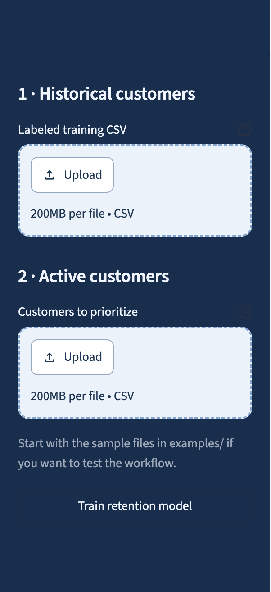
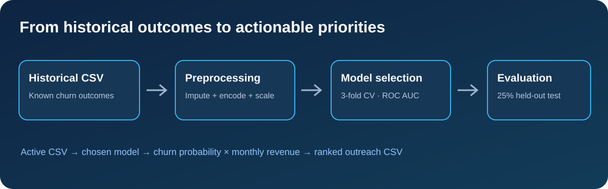
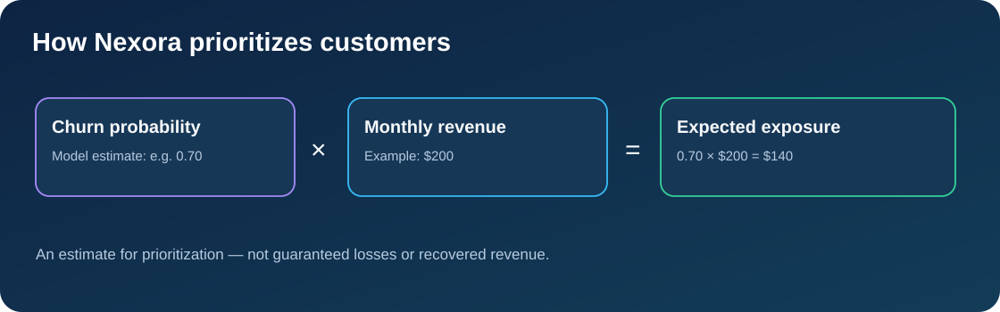

<div align="center">

# ◇ Nexora AI
### Customer Retention Intelligence

**Predict customer churn · Understand model reliability · Prioritize outreach**

    

*A practical, exploratory ML decision-support application for subscription businesses.*

[Quick start](#-quick-start) · [Architecture](#-machine-learning-pipeline) · [Data requirements](#-dataset-requirements) · [Limitations](#-limitations--responsible-use)

</div>

---

## 🛠️ Technology Stack

| Component | Technologies / Methods |
|---|---|
| **Programming** | Python |
| **Data processing** | Pandas, NumPy |
| **Machine learning** | Scikit-learn, classification pipelines |
| **Data preprocessing** | Missing-value imputation, categorical encoding |
| **Model evaluation** | Classification metrics, train/test evaluation |
| **Business intelligence** | Churn probability, customer prioritization, revenue-at-risk estimation |
| **Dashboard** | Streamlit, Plotly |
| **Testing** | Pytest |
| **Version control** | Git, GitHub |

---

## 🎯 The problem

Retention teams need to decide **which customers to contact first**. Nexora AI uses past churn outcomes to estimate the churn risk of **separate active customers**, then ranks them by **estimated monthly revenue exposure**. It supports outreach planning; it does **not** predict whether an intervention will succeed.

## 🖥️ Application preview

The sidebar accepts two CSV files: labeled historical customers for training and current customers for scoring.



> Screenshot: upload interface from the working local application. For the complete dashboard, launch the app and open **Business overview**, **Customer priorities**, and **Model reliability**. A full dashboard screenshot can be added to `assets/` later.

## 🔁 Machine-learning pipeline



**Training:** A stratified **75/25 train/test split** separates evaluation data. On the training partition only, Nexora compares **logistic regression** and **random forest** using **3-fold stratified cross-validation** and mean **ROC AUC**. Preprocessing is fitted inside each pipeline: median imputation and scaling for numeric inputs; most-frequent imputation and one-hot encoding for categorical inputs. The selected model is evaluated on the held-out 25% using ROC AUC, precision, recall, F1, accuracy, and a confusion matrix. Permutation importance is exploratory, not causal.

**Scoring:** The trained model predicts churn probabilities for a separate active-customer file. The app assigns illustrative risk bands and exports a prioritized CSV.



The exported list is ranked by **`ChurnProbability × MonthlyRevenue`**, not simply by churn probability. These amounts are planning estimates, **not** guaranteed lost or recoverable revenue.

## ✨ What the dashboard includes

| Area | Capabilities |
| --- | --- |
| **Historical data overview** | Record count, column count, missing cells, preview, supported schema |
| **Business overview** | Active customer count, high-risk count, expected monthly exposure, risk distribution |
| **Customer priorities** | Risk bands, ranked outreach list, downloadable CSV |
| **Model reliability** | Cross-validation comparison, holdout metrics, confusion matrix, permutation importance |

## 🚀 Quick start

```bash
git clone https://github.com/YoussefMouhi/Nexora-AI-Customer-Retention.git
cd Nexora-AI-Customer-Retention
python3 -m venv .venv
.venv/bin/python -m pip install -r requirements.txt
.venv/bin/python -m streamlit run app.py
```

Open the local address printed by Streamlit (normally `http://localhost:8501`). On Windows, the equivalent interpreter is `.venv\Scripts\python.exe`.

**Try the included synthetic CSVs:**

1. Upload `examples/historical_customers.csv` under **Historical customers**.
2. Upload `examples/active_customers.csv` under **Active customers**.
3. Click **Train retention model**; review the three dashboard tabs and export the ranked list.

No sample data is loaded automatically. Both CSVs are **synthetic demonstration data**, not real customer records.

## 📊 Dataset requirements

| Column | Historical CSV | Active CSV | Role |
| --- | --- | --- | --- |
| `CustomerID` | Required | Required | Unique identifier, **not a predictor** |
| `Churn` | Required | Not required | Historical target (`Yes`/`No`, `1`/`0`, or `Exited`/`Stayed`) |
| `MonthlyRevenue` | Required | Required | Predictor and revenue exposure calculation |
| `TenureMonths` | Supported | Required if used in training | Relationship duration |
| `ContractType` | Supported | Required if used in training | Contract category |
| `SupportTickets` | Supported | Required if used in training | Support activity |
| `PaymentMethod` | Supported | Required if used in training | Payment category |
| `InternetService` | Supported | Required if used in training | Service category |

**Exact schema rules:** At least **two supported predictive columns** must be present in historical data (counting `MonthlyRevenue`). The active CSV must include **all features selected during training**, with matching column names. Extra columns are ignored. `UsageFrequency`, `LastActivityDays`, `SatisfactionScore`, and `PaymentDelays` are **not supported in V1** and are ignored even if uploaded.

**Technical minimum:** 60 unique labeled historical customers and at least 12 of each outcome. This is a software constraint, **not a guarantee of reliable prediction**. Real applications typically need more representative records and churn events.

**Data quality matters:** Use a consistent observation date and churn horizon (for example, churn in the following 30 days); use only information available *before* that horizon. Check missing values, duplicates, inconsistent categories, class balance, temporal drift, and training-versus-active population differences. Exclude cancellation dates, reasons, and other post-outcome features to prevent leakage.

## 🧪 Tests

```bash
.venv/bin/python -m pytest -q
```

Six automated tests are included under `tests/`. Run them in your own environment before deployment. Model metrics depend on the supplied dataset and should not be presented as real-world performance claims.

## 📁 Repository structure

```text
Nexora-AI-Customer-Retention/
├── app.py                     # Streamlit UI
├── src/retention.py           # Data checks, training, scoring
├── examples/
│   ├── historical_customers.csv
│   └── active_customers.csv
├── assets/
│   ├── upload-sidebar.png     # Actual interface screenshot
│   ├── pipeline.svg           # ML workflow
│   └── scoring.svg            # Prioritization model
├── tests/test_retention.py
├── requirements.txt
├── LICENSE
├── NOTICE                     # Copyright / attribution notice
└── README.md
```

## ⚠️ Limitations & responsible use

- **Prototype, not production-ready:** The supplied datasets are synthetic. Validate using representative real data and a suitable out-of-time holdout before operational use.
- **Probability calibration:** Scores are not explicitly calibrated; risk bands (Low &lt;35%, Medium 35–65%, High ≥65%) are illustrative, not optimized.
- **No causal claims:** Feature importance is not causality. High churn risk does not imply a customer can be retained by an intervention.
- **Privacy & fairness:** Use authorized, appropriately protected customer data; review bias, drift, and relevant obligations. Do not use this prototype for consequential automated decisions about individuals.
- **Revenue exposure:** `probability × revenue` is an estimate for ranking, not a forecast of guaranteed losses or recovered revenue.

## 📜 License & attribution

Licensed under the **Apache License 2.0**; see [`LICENSE`](LICENSE). See [`NOTICE`](NOTICE) for the copyright notice relating to original contributions. This focused application follows an earlier general-purpose Nexora prototype adapted from open-source work; **the upstream repository should be identified here before claiming the entire codebase as original**. Retain all applicable upstream notices and licenses.

---

<div align="center"><sub>Built as a Data Science &amp; AI portfolio project · Nexora AI · 2026</sub></div>
